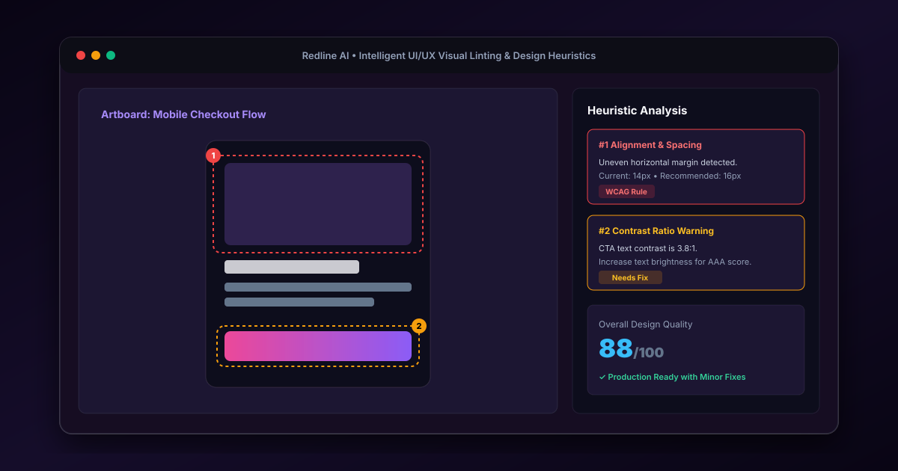

<div align="center">
  

  # 🔍 Redline Critique AI
  <p><strong>Automated UI/UX heuristic critique, visual linting & design system auditor.</strong></p>

  <p>
    <a href="https://artful-critique-ai.lovable.app"></a>
    
    
    
    
  </p>
</div>

---

## 📌 What is Redline AI?

**Redline Critique AI** analyzes user interfaces, wireframes, and design mockups against established human-computer interaction (HCI) heuristics and accessibility benchmarks (WCAG 2.1). By parsing design composition, spacing consistency, and typography hierarchy, it provides actionable, production-grade recommendations for UI/UX designers and frontend engineers.

---

## ⚡ Key Capabilities
- **Visual Linting & Redlining:** Highlights misalignment, erratic padding, and broken grid baselines directly over uploaded artboards.
- **Accessibility & Contrast Scrutiny:** Evaluates color contrast ratios against AA and AAA standards to guarantee legibility.
- **Design Heuristic Scorecard:** Grades interfaces across 10 Nielsen-Norman usability principles with itemized improvement suggestions.
- **Instant Cloud Persistence:** Synchronizes critique sessions and audit histories using Supabase.

---

## 📁 Repository Structure

```
Redline-critique-ai/
├── docs/images/            # High-resolution architectural previews & benchmarks
├── src/
│   ├── components/         # Radix-backed UI atoms, modals, and design cards
│   ├── hooks/              # Custom React hooks (canvas render, theme, state)
│   ├── pages/              # Landing page, critique stage, and audit reports
│   ├── lib/                # Utility helpers & Supabase client bindings
│   ├── App.tsx             # Route orchestration & global providers
│   └── main.tsx            # DOM initialization
├── supabase/               # Migrations, seed definitions, and edge functions
├── .env.example            # Environment template for local development
└── vite.config.ts          # Build pipeline and bundling configuration
```

---

## 🚀 Getting Started Locally

### 1. Prerequisites
- **Node.js**: `v18.x` or higher
- **Package Manager**: `npm`, `pnpm`, or `bun`

### 2. Setup
```bash
# Clone the repository
git clone https://github.com/Shubhamd7744/Redline-critique-ai.git
cd Redline-critique-ai

# Install dependencies
npm install

# Setup environment variables
cp .env.example .env

# Launch development server
npm run dev
```

Open [http://localhost:5173](http://localhost:5173) in your browser.

---

## 🛡️ Security & Environment Notice
All sensitive backend keys are strictly isolated. For custom deployments, supply your credentials in `.env`:
```env
VITE_SUPABASE_URL=https://your-project.supabase.co
VITE_SUPABASE_ANON_KEY=your-anon-key-here
```

---

<div align="center">
  <sub>Maintained by <a href="https://github.com/Shubhamd7744">Shubham Dutta</a> • UI/UX Designer & Frontend Developer</sub>
</div>